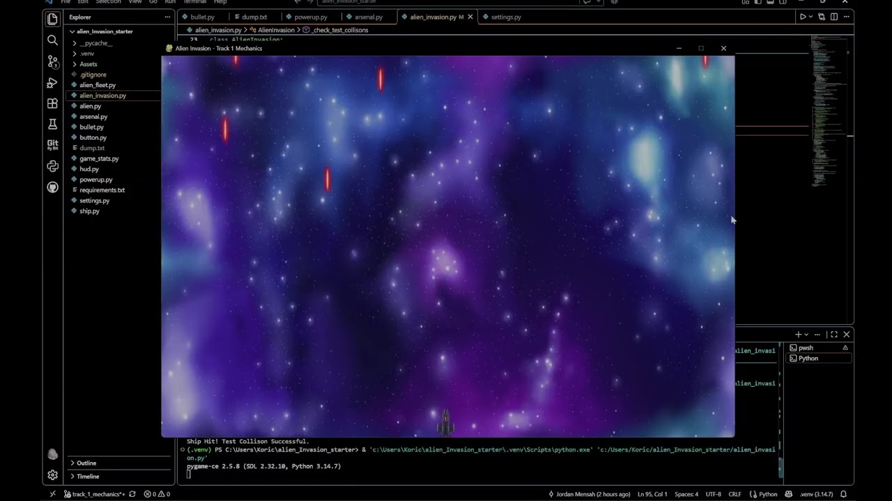

[!()](https://www.youtube.com/watch?v=W0y6rxN600M)
# Click Thumbnail To Watch Video
# Final Project - Milestone 1 Mechanics

**Author**: Jordan Mensah
**Date**: 11/15/26

**Description**

A customized space invaders style game called alien invasion. For Track 1 Milestone 1 this game has been enhanced with custom gameplay mechanics such as falling environmental powerups, enemy return fire, and weapon upgrades (spread shot).

**Features**

* Enemy Return Fire
* Falling Environmental Powerups
* Dynamic Weapon Upgrades

**Controls**

* Left/Right Arrow Keys: Movement
* Spacebar: Fire Weapon
* Q: Quit Game

**Acknowledgements**

* [Project Guidelines](https://courses.cscc.edu/ultra/courses/_238744_1/assessment/_28741564_1/attempt/create?courseId=_238744_1)
* [Python Online Textbook](https://learning.oreilly.com/library/view/python-crash-course/9781098156664/)
* [Direct Video Link](https://www.youtube.com/watch?v=W0y6rxN600M)